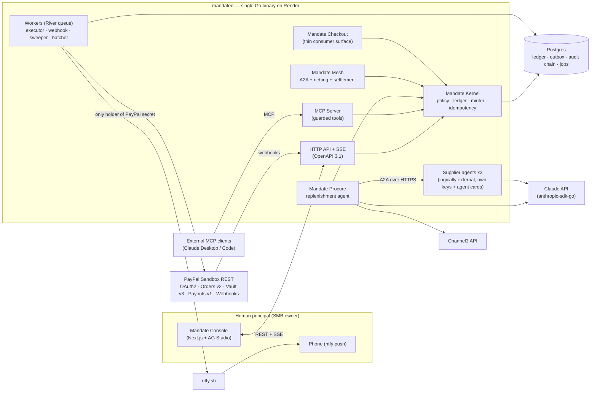
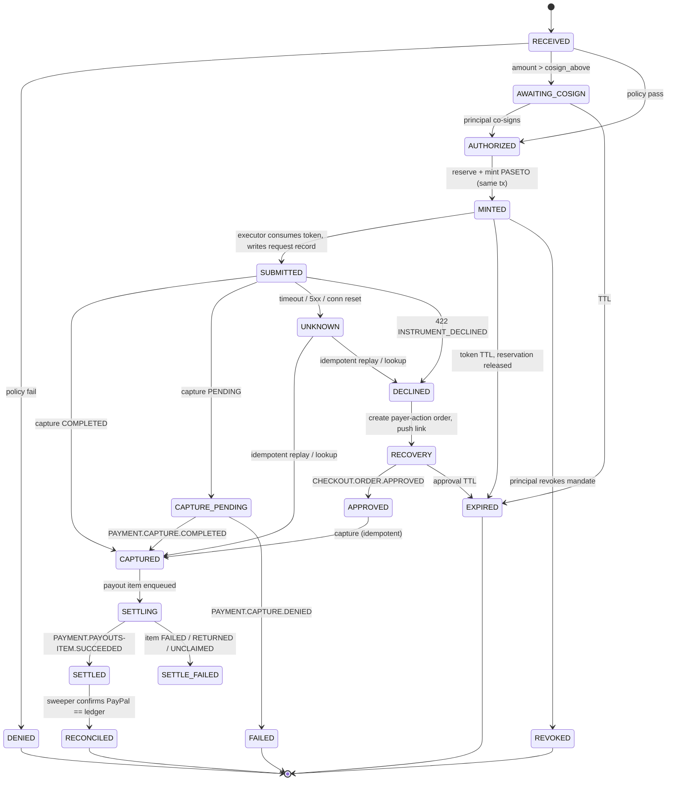
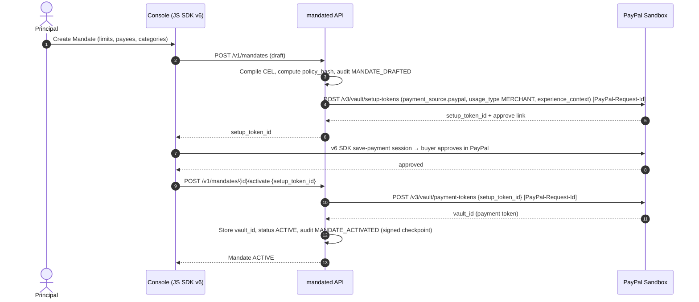
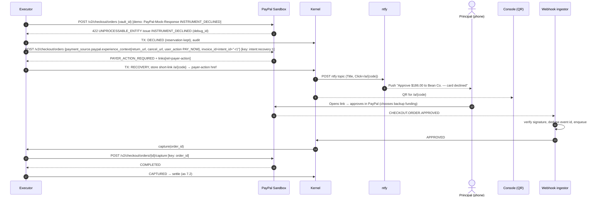
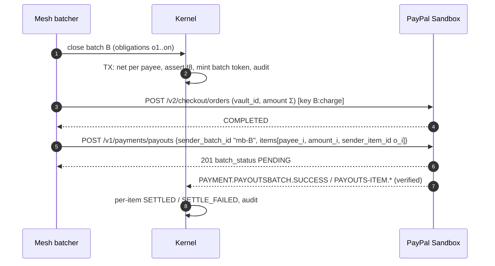

# Mandate — System Architecture Blueprint

> *Signed authority for autonomous commerce.*
> Status: **v1.1 — PayPal assumptions verified against official sources (§16)** · Updated: 2026-10-17 · Owner: Mandate core team
> Companion: [ADR-0001 Repository Structure](../adr/0001-repository-structure.md)

---

## 0. Locked Decisions (Decision Log)

| # | Decision | Choice | Rationale (short) |
|---|---|---|---|
| D1 | Platform name | **Mandate** (`mandate-os`) | A mandate is the payments instrument by which a principal authorizes future debits. |
| D2 | Funding model | **JIT vault charge** | User vaults PayPal once (Vault v3); each authorized intent charges *exactly* the reserved amount via Orders v2 `vault_id` (merchant-initiated), then suppliers are paid via Payouts. Works on a standard sandbox app. Platform vault (`usage_type: PLATFORM`, `payee.merchant_id`) is the production upgrade path. |
| D3 | Topology | **Modular monolith** | One Go module, one binary (`mandated`), API + workers as goroutines. No distributed transactions on the money path. |
| D4 | Golden demo path | **Procure → Kernel → Mesh** | Mirrors PayPal's own published inspiration: *"two agents negotiating and settling a payment between themselves."* |
| D5 | Capability token | **PASETO v4.public** (Ed25519) | No `alg` confusion class; mature Go lib (`aidanwoods.dev/go-paseto`). Sub-mandates are re-minted (online narrowing). |
| D6 | Backend language | **Go** (no Rust) | No official PayPal Go server SDK → hand-written `net/http` client with full per-call header control (fixes `agent-toolkit#98` by construction). Stdlib `crypto/ed25519`. |
| D7 | Frontend | **TypeScript, Next.js 16 + React 19 + Tailwind 4 + AG Studio** | Matches PayPal's official AG Studio boilerplate stack (reference only — it has no license file; do not copy). |
| D8 | Sponsor prize bet | **AG Grid / AG Studio** (single sponsor prize; rules §8 forbid stacking) | Criteria explicitly reward custom widgets, theming, and the **Studio Agent Framework**. |
| D9 | Bryntum | **Dropped** | Second licensed UI lib; no golden-path need. |
| D12 | Procure demo goods | **Café equipment & smallwares** (frothing pitchers, grinders) | Live Channel3 test (2026-10-17): consumables like coffee beans are poorly covered; equipment/smallwares return clean categories (`frothing-pitchers`, `coffee-grinders`) with real price spreads. |
| D13 | Runtime PayPal access | **Direct REST, not the PayPal MCP server or Agent Toolkit** | PayPal's own MCP guidance: *"For full control over request structure, fall back to the REST API directly."* The kernel needs per-call `PayPal-Request-Id` control, which `agent-toolkit` still lacks (`#98` open, fix PR #108 unmerged, verified 2026-10-17). |
| D10 | Step-up channel | **ntfy push + console QR** | Free, no account, no trial expiry; QR covers judges testing the hosted build. |
| D11 | Other sponsors | Channel3 **kept** (sourcing/benchmark); APIMatic Context Plugin **used during development**; Postman **collection published**; Render **hosting**; Elastic / KERNEL / Astropods / Zapier **not used** | See §12. |

### 0.1 Hard external constraints (from Devpost rules, scraped 2026-10-12)

- **Submission deadline:** 2026-11-12 12:00 PT. **Judging:** 2026-12-01 → 2026-12-15. The hosted build **must stay testable until 2026-12-15** (rules §Testing).
- **Prize ceiling:** one Grand *or* one Honorable Mention **plus one** Sponsor prize. Max realistic capture = $12,000 + $5,000.
- **Repo:** public, open-source license detectable on GitHub (MIT already present).
- **Video:** < 3 min, YouTube public, shows the product running.
- **AG Grid / AG Studio licensing — resolved:** the AG Grid team confirmed on the PayPal Discord (2026-10-08) that *"all of our products can be used without a licence for testing purposes, including this hackathon"*. Components show a watermark and a console error, which *"we won't penalise you for"*. Record the demo video early.
- **Hosting budget:** $50 Render credits must cover ~2 months → one Go web service (Starter) + one Postgres instance + console as a free static site.

---

## 1. Problem Statement (what the architecture must defeat)

| Failure mode in today's PayPal agent stack | Evidence | Mandate's structural answer |
|---|---|---|
| Retries create duplicate orders/refunds; configured key collides across all calls | `paypal/agent-toolkit#98`, PR #108 | Per-operation idempotency keys derived from durable identifiers, written *before* the network call (§6). |
| Refund key derivation `${capture_id}-${amount}-${invoice_id}` collides for two legitimate equal partial refunds | PR #108 derivation | Refund keys use a ledger-allocated `refund_seq`, never the amount (§6.2). |
| No argument-level admission control; `$5` == `$50,000` | PR #91 | Deterministic policy kernel evaluates every intent's arguments before any credential exists (§4). |
| Tax/total serialization mismatch → 422 loops | PR #110 | All money is `int64` minor units; breakdown invariants are checked locally before submission (§7.5). |
| Published MCP schema ≠ server validator | `paypal/paypal-mcp-server#7` | One OpenAPI 3.1 contract generates server + client; CI fails on drift (ADR-0001). Mandate's MCP tools call PayPal REST directly — no dependency on `mcp.paypal.com`. |
| Silent sandbox fallback when `environment` omitted | `paypal/paypal-js#945` | Environment is a **required** config with no default; boot refuses on mismatch between `PAYPAL_ENV` and base URL (§10). |
| Headless `422 INSTRUMENT_DECLINED` strands order in `PAYER_ACTION_REQUIRED` | developer_and_github_issues §2.1 | Out-of-band `payer-action` recovery loop (§7.3). |
| ~8% of subscription-cancel webhooks never generated | `paypal-js#578` | Reconciliation sweeper treats webhooks as hints, never as the sole source of truth (§7.6). |

**Honest scope statement for the pitch:** Mandate does **not** stop an LLM from being fooled by prompt injection. It **bounds the blast radius**: a fooled agent can only propose intents; it can never mint authority it was not granted.

---

## 2. System Context



**Trust boundaries**

1. **LLM boundary.** Anything produced by an LLM, Channel3, or a supplier agent is *untrusted data*. It enters the kernel only as a schema-validated `Intent`.
2. **Credential boundary.** The PayPal client secret lives only in the `mandated` process environment, and is used only by the executor worker package (`internal/paypal`). The agent, MCP, and console packages cannot import it (enforced by Go `internal/` visibility + a `depguard` lint rule).
3. **Execution boundary.** The executor accepts **only** a valid, unconsumed PASETO capability. A bug in any agent-facing handler cannot cause a spend without a token minted by the policy path.
4. **Supplier boundary.** Supplier agents are co-hosted for budget reasons, but they talk to Procure only via public A2A HTTPS, sign quotes with their own Ed25519 keys, and have no database access.

---

## 3. Module Breakdown (packages inside one Go module)

| Package | Responsibility | Key dependencies |
|---|---|---|
| `internal/kernel/policy` | Compile + evaluate mandate policies (CEL), pure function | `github.com/google/cel-go` |
| `internal/kernel/ledger` | Envelopes, reservations, captures, refunds, settlements; ACID invariants | Postgres, `sqlc` |
| `internal/kernel/token` | PASETO v4.public mint/verify/consume; key rotation | `aidanwoods.dev/go-paseto` |
| `internal/kernel/idem` | Idempotency key derivation + write-ahead request records | — |
| `internal/kernel/fsm` | Intent state machine; legal transitions only | — |
| `internal/kernel/audit` | Hash-chained audit log, Ed25519 checkpoints, verifier | `crypto/ed25519`, JCS (RFC 8785) |
| `internal/paypal` | Hand-written REST client: OAuth2 token cache, Orders v2, Vault v3, Payouts v1, webhook verification, `PayPal-Mock-Response` (sandbox only) | `net/http` |
| `internal/mesh` | A2A client/server, quote signing, micro-obligation netting, payout batching | A2A Go SDK (spike: `a2aproject/a2a-go`) |
| `internal/procure` | Stock-level signal, Channel3 benchmark, RFQ/negotiation agent | Channel3 REST |
| `internal/checkout` | Thin consumer chat surface that reuses the kernel (secondary path) | — |
| `internal/agent` | LLM tool-calling loop; strict JSON-schema tool I/O | `github.com/anthropics/anthropic-sdk-go` |
| `internal/mcp` | MCP server exposing *guarded* tools (`propose_purchase`, `get_mandate`, `list_decisions`) | `github.com/modelcontextprotocol/go-sdk` |
| `internal/notify` | ntfy push for step-up; redirect short-links | `net/http` |
| `internal/jobs` | Durable Postgres-backed job queue | `github.com/riverqueue/river` |
| `cmd/mandated` | Wires everything; flags for roles (`--api --workers --suppliers`) | — |
| `cmd/mandatectl` | CLI: create mandate, verify audit chain offline, replay scenarios | — |

> **Why one binary is still "an OS":** module boundaries are enforced at compile time, and every cross-module call goes through kernel interfaces. Splitting `kernel` into its own service later is a deployment change, not a redesign.

---

## 4. Mandate & Policy Model

### 4.1 Mandate (what a principal signs)

```text
Mandate {
  id            ULID
  principal_id  user
  agent_id      the agent this authority is delegated to
  vault_id      PayPal Vault v3 payment token (payer's PayPal)
  envelope      { currency: "USD", limit_minor: 60000, period: P7D }      // $600 / week
  per_intent    { max_minor: 25000 }                                     // $250 / order
  cosign_above  { minor: 20000 }                                         // human co-sign over $200
  velocity      [ { window: PT10M, max_count: 5 }, { window: PT1H, max_minor: 40000 } ]
  payees        allowlist of supplier refs → PayPal receiver email/payer_id + supplier Ed25519 pubkey
  categories    allowlist (Channel3 category ids)
  rules         CEL expressions (optional, typed)
  valid         [not_before, not_after]
  policy_hash   SHA-256(JCS(policy fields))      // bound into every token + audit entry
  status        ACTIVE | PAUSED | REVOKED
}
```

> **Not "MCC locks":** the payer side never sees the merchant category code on PayPal. We bind by **payee identity** (PayPal receiver + supplier signing key) and by **Channel3 category**.

### 4.2 Evaluation (deterministic, LLM-free)

`Decision = Evaluate(Mandate, Intent, LedgerSnapshot)`, where `LedgerSnapshot` is read **inside the same DB transaction** that will reserve funds.

Ordered checks (first failure wins; every reason code goes to the audit log):

1. `MANDATE_INACTIVE`: status/validity window.
2. `SCHEMA_INVALID`: intent failed strict schema validation.
3. `PAYEE_NOT_ALLOWED`: `intent.payee_ref ∉ mandate.payees`.
4. `QUOTE_SIGNATURE_INVALID`: supplier signature over `JCS(quote)` fails against the **allowlisted** pubkey (not a key supplied in the message).
5. `QUOTE_MISMATCH`: `intent.amount ≠ quote.total` or the quote is expired.
6. `CATEGORY_NOT_ALLOWED`.
7. `PER_INTENT_EXCEEDED`.
8. `ENVELOPE_EXCEEDED`: `reserved + captured + intent.amount > limit` for the current period.
9. `VELOCITY_EXCEEDED`: sliding-window count/amount from the ledger.
10. `CEL_RULE_FAILED:<rule_id>`.
11. `COSIGN_REQUIRED` (not a denial): moves to `AWAITING_COSIGN`.

Ordering checks by payee/signature before amounts means an injected "pay attacker $4,800" intent dies at step 3. The demo shows the exact reason code.

CEL is used because it is non-Turing-complete, side-effect free, type-checked at mandate creation, and supports cost limits. That makes evaluation provably terminating and deterministic.

---

## 5. Intent State Machine



### 5.1 Invariants (enforced in the database, not just in Go)

| ID | Invariant | Enforcement |
|---|---|---|
| **I1** | ∀ envelope e, period p: `Σ reserved(e,p) + Σ captured(e,p) ≤ limit(e)` | Reservation insert runs under `SELECT … FOR UPDATE` on the envelope row; a `CHECK`-backed running total column. |
| **I2** | `captured_amount(intent) ≤ token.ceiling` | Executor GETs the order before capture; the Postgres `CHECK` on captures references the reservation amount. |
| **I3** | At most one successful capture per intent | `UNIQUE (intent_id) WHERE status = 'COMPLETED'` on `captures`. |
| **I4** | Tokens are single-use | `UPDATE tokens SET consumed_at = now() WHERE jti = $1 AND consumed_at IS NULL RETURNING …`; zero rows ⇒ reject. |
| **I5** | Only legal FSM edges | `intent_transitions(from, to)` table + trigger rejecting other updates; optimistic `version` column. |
| **I6** | Audit chain is gapless and unbroken | `seq` gapless under a chain-head row lock; `hash = SHA-256(prev_hash ‖ JCS(entry))`. |
| **I7** | Every state change has exactly one audit entry | Audit append happens in the **same transaction** as the state update (no dual write). |
| **I8** | Money conservation per settlement batch | `Σ payout_items(batch) = Σ obligations netted into batch`, checked before the Payouts call. |

Reservations are released on `DENIED / EXPIRED / REVOKED / FAILED`, and converted to captured amounts on `CAPTURED`. When an amount is captured on the recovery path, it is matched against the **same** reservation; there is never a second reservation.

---

## 6. Idempotency Architecture (the `#98` fix, generalized)

### 6.1 Rules

1. **Keys come from durable identifiers, never from the current time or a random value at call time.** The same logical operation always produces the same key; distinct operations always produce distinct keys.
1a. **Format.** PayPal's guidance is *"a unique UUID on every POST request — reuse the same value on retries"*; the Orders schema accepts any 1–10,000-char string and its example value is a UUID. Keys are therefore emitted as **RFC 9562 UUIDv8** built from SHA-256 over the durable scope: UUID-shaped, deterministic, and reused verbatim on retry.
2. **Write-ahead.** The `paypal_requests` row `(key, op, intent_id, request_body_hash, state=PENDING)` is committed **before** the HTTP call. A crash at any point is recovered by replaying with the same key.
3. **Ambiguity is a state, not an error.** Timeout, 5xx or connection reset → `UNKNOWN` → replay with the identical key and body. If the replay is outside PayPal's retention window for that endpoint (it is finite and varies by API, so we never rely on it), fall back to lookup by our reference (`custom_id` / `invoice_id` = `intent_id`).
4. **Defense in depth on PayPal's side.** Orders set `purchase_units[].invoice_id = intent_id`. PayPal rejects duplicate invoice IDs for a merchant, so this gives a second, server-side duplicate barrier independent of `PayPal-Request-Id`.
5. **Per-call header injection.** `internal/paypal.Do(ctx, op Operation)`: `Operation` carries its own `IdempotencyKey`. The client has **no** client-level request-id field. The `#98` bug is unrepresentable.

### 6.2 Derivation table

`key = UUIDv8(SHA-256(op ‖ length-prefixed scope parts))`

| Operation | API | Scope (durable identifiers) | Notes |
|---|---|---|---|
| Vault setup token | `POST /v3/vault/setup-tokens` | `principal_id:setup_attempt_n` | |
| Vault payment token | `POST /v3/vault/payment-tokens` | `setup_token_id` | |
| JIT order (vault) | `POST /v2/checkout/orders` | `intent_id:primary` | `invoice_id = intent_id` |
| Recovery order | `POST /v2/checkout/orders` | `intent_id:recovery:n` | new order, same reservation |
| Capture | `POST /v2/checkout/orders/{id}/capture` | `order_id` | |
| Refund | `POST /v2/payments/captures/{id}/refund` | `capture_id:refund_seq` | `refund_seq` allocated in ledger; **never amount-derived** (two equal partial refunds must not collide) |
| Payout batch | `POST /v1/payments/payouts` | `sender_batch_id = "mb-" + batch_ulid` | Documented dedupe: *"If you specify a `sender_batch_id` that was used in the last 30 days, the API rejects the request."* `sender_item_id = obligation_id`, reused on retries (PayPal Payouts guidance). The Payouts schema documents no `PayPal-Request-Id`, so we rely on these two fields only. |

---

## 7. PayPal Call Flows

### 7.1 One-time mandate onboarding (vault without purchase)



> **Verified against PayPal's official v6 sample (`paypal-examples/v6-web-sdk-sample-integration`, `savePayment` + `vaultRouteHandler.ts`):**
> - The SDK is initialised with a **server-generated client token** (`POST /v1/oauth2/token`, `response_type=client_token`, `domains[]`), not a client ID. PayPal: *"Use `clientToken` only when the integration requires vaulting or Fastlane."*
> - Eligibility: `findEligibleMethods({ currencyCode: "USD", paymentFlow: "VAULT_WITHOUT_PAYMENT" })`, then `createPayPalSavePaymentSession()`.
> - Setup token body: `payment_source.paypal = { usage_type: "MERCHANT", experience_context: { return_url, cancel_url, vault_instruction: "ON_PAYER_APPROVAL" } }`.
> - Payment token body: `payment_source.token = { id: <setup_token>, type: "SETUP_TOKEN" }`. The resulting ID is long-lived and is **kept server-side only**, per the sample's comment.
> - Remaining sandbox check (S1): the app must have vaulting enabled, otherwise the documented create-order error is `NOT_ENABLED_TO_VAULT_PAYMENT_SOURCE`.

### 7.2 Golden path — Procure → Kernel → Mesh (happy path)

```mermaid
sequenceDiagram
    autonumber
    participant INV as Stock signal
    participant PR as Procure agent (LLM)
    participant C3 as Channel3
    participant SA as Supplier agents (A2A)
    participant K as Kernel
    participant EX as Executor worker
    participant PP as PayPal Sandbox
    participant UI as AG Studio (SSE)

    INV->>PR: 2 frothing pitchers broken; par level 8, on hand 2 (restock 6)
    PR->>C3: search(product, category) → retail price benchmark
    PR->>SA: A2A discover (agent cards) → RFQ {sku, qty, deliver_by}
    SA-->>PR: Signed quotes (Ed25519 over JCS(quote))
    PR->>SA: Negotiate (bounded rounds) using benchmark
    SA-->>PR: Final signed quote Q ($186.00, expires 10m)
    PR->>K: Intent {payee_ref, quote Q, amount 18600, category}
    K->>K: TX: lock envelope → Evaluate → reserve → mint PASETO → audit (×3)
    K-->>UI: SSE decision AUTHORIZED / MINTED
    K->>EX: enqueue execute(jti) (River, same tx via outbox)
    EX->>EX: consume token (I4), write-ahead paypal_requests
    EX->>PP: POST /v2/checkout/orders {intent CAPTURE, payment_source.paypal{vault_id, stored_credential{payment_initiator MERCHANT, usage_pattern IMMEDIATE}}, invoice_id=intent_id} [key: intent:primary]
    PP-->>EX: 201 COMPLETED (capture id) — or see 7.3
    EX->>K: TX: CAPTURED, convert reservation, audit
    K->>EX: enqueue settle(intent) → obligation to supplier
    EX->>PP: POST /v1/payments/payouts {sender_batch_id, items[]} (batched, §7.4)
    PP-->>EX: 201 batch PENDING
    PP-->>K: webhook PAYMENT.PAYOUTS-ITEM.SUCCEEDED (verified)
    K-->>UI: SSE SETTLED, chain head updated
```

> **Verified:**
> - PayPal's official sample states that *"creating an order with `payment_source.paypal.vault_id` charges it immediately (COMPLETED)"*, so the vault charge is one call with no separate capture.
> - `stored_credential` fields come from the Orders v2 schema. `payment_initiator: MERCHANT` means *"initiated by merchant on behalf of the customer without the active engagement of customer."* `usage_pattern: IMMEDIATE` means *"On-demand instant payments – non-recurring, pre-paid, variable amount, variable frequency."* `usage` is left at its default `DERIVED`, so PayPal derives FIRST/SUBSEQUENT itself.
> - The executor still handles `CREATED`/`APPROVED` defensively with a capture keyed on `order_id`.

### 7.3 `422 INSTRUMENT_DECLINED` → payer-action recovery loop



- **Verified:** `INSTRUMENT_DECLINED` is a documented **create-order** `UNPROCESSABLE_ENTITY` error (*"The instrument presented was either declined by the processor or bank, or it can't be used for this payment"*). PayPal's negative-testing page lists Orders v2 *create order* among the endpoints that accept `PayPal-Mock-Response: {"mock_application_codes": "<error_name>"}`.
- **Verified:** PayPal's guidance is to handle `INSTRUMENT_DECLINED` *"by prompting for a different payment method — do not auto-retry"*. The recovery loop does exactly this: the buyer chooses another funding source in PayPal's own approval UI, and nothing retries the declined instrument.
- The decline in the demo is **triggered deliberately** using PayPal's sandbox negative-testing header (`PayPal-Mock-Response`). The video says so explicitly. Honesty is part of the Presentation score. The header is compiled out of non-sandbox builds (build tag `sandbox`).
- The short-link means no PayPal URL or token ever travels through ntfy. The ntfy topic is a random 128-bit name.
- If `return_url` is hit before the webhook arrives, the API handler enqueues the same `capture(order_id)` job. The idempotency key makes the race harmless.

### 7.4 Mesh — micro-obligations, netting, batched payouts

Micro-tasks (for example a "logistics ETA agent" at $0.35 or a "price-verification agent" at $0.40) are **not** charged one by one.

1. Each accepted micro-task creates an **obligation** `(payee_ref, amount_minor, intent_id)` that is reserved against the envelope (I1 still holds).
2. The batcher closes a batch when `Σ ≥ threshold` or `age ≥ T` (demo: 60 s). It nets obligations per payee and runs **one** JIT vault charge for the batch total (key `batch_ulid:charge`).
3. After that capture completes, it sends **one** Payouts call with one item per payee (`sender_item_id = obligation_id`).
4. I8 (money conservation) is checked before submission. Item-level failures (`UNCLAIMED`, `RETURNED`) re-open those obligations only.



### 7.5 Money representation

- Money is `int64` minor units plus an ISO-4217 currency everywhere internally. Conversion to PayPal's decimal strings happens in exactly one function.
- Before every Orders call, the client asserts `amount.value == item_total + tax_total + shipping − discount`, and `item_total == Σ unit_amount × qty`, all computed in integers. This prevents the PR #110 class of `422` loops locally.

### 7.6 Webhook ingestion & reconciliation

1. **Verify via PayPal's API, not local crypto.** PayPal: *"Always verify webhook signatures using `POST /v1/notifications/verify-webhook-signature` before processing any event."* We send `auth_algo`, `cert_url`, `transmission_id`, `transmission_sig`, `transmission_time` (from the `PAYPAL-*` headers), `webhook_id`, and the event parsed from the **raw** body (PayPal RulesHub: *"body altered by middleware"* is the top cause of verification failures).
   - Return HTTP 200 immediately and process asynchronously, because PayPal retries if no 200 arrives within 30 s.
   - Subscribe to **explicit event types**, not wildcards (PayPal guidance).
2. **Dedupe.** Insert `event_id` into `webhook_events` with `UNIQUE(event_id)`; a conflict means ack and drop.
3. **Apply.** Map event to FSM transition. Subscribed events (names verified against PayPal's event-names page, 2026-10-17):
   - `CHECKOUT.ORDER.APPROVED` → `APPROVED`
   - `PAYMENT.CAPTURE.COMPLETED` → `CAPTURED`
   - `PAYMENT.CAPTURE.PENDING` → `CAPTURE_PENDING`
   - `PAYMENT.CAPTURE.DENIED` / `PAYMENT.CAPTURE.DECLINED` → `FAILED`
   - `PAYMENT.CAPTURE.REFUNDED` / `PAYMENT.CAPTURE.REVERSED` → ledger adjustment
   - `PAYMENT.PAYOUTS-ITEM.SUCCEEDED` → `SETTLED`
   - `PAYMENT.PAYOUTS-ITEM.HELD` → stays `SETTLING`
   - `PAYMENT.PAYOUTS-ITEM.{FAILED,BLOCKED,RETURNED,UNCLAIMED,REFUNDED,CANCELED}` → `SETTLE_FAILED`
   - `PAYMENT.PAYOUTSBATCH.{SUCCESS,DENIED,PROCESSING}` → batch status
   - `VAULT.PAYMENT-TOKEN.DELETED` → **mandate auto-paused**: the payer revoked consent inside PayPal itself.

   Then: Transitions that would move a state backwards are ignored and audited as `STALE_EVENT`, so out-of-order delivery is safe.
4. **Reconcile.** The sweeper runs every 2 minutes. It GETs every intent in a non-terminal state older than 5 minutes from PayPal, and converges the ledger to PayPal's state. Webhooks are treated as hints; this sweeper is how the ledger converges.

---

## 8. Capability Token (PASETO v4.public)

```json
{
  "iss": "mandate-kernel",
  "aud": "mandate-executor",
  "sub": "agent:procure-01",
  "jti": "01JA…",                       
  "iat": "2026-11-03T10:15:00Z",
  "exp": "2026-11-03T10:25:00Z",
  "mid": "mandate:01J9…",
  "iid": "intent:01JA…",
  "ops": ["vault_charge"],
  "payee": "supplier:bean-co",
  "ceil": { "cur": "USD", "minor": 18600 },
  "ph":  "sha256:…policy_hash",
  "qh":  "sha256:…quote_hash"
}
```

- Footer carries `kid` for key rotation. Public keys are published at `/.well-known/mandate-keys.json`.
- **Honest framing.** In the single-binary deployment the token is an *internal* capability boundary between the decision path and the execution path. It becomes a cross-organization credential when Mesh hands narrowed sub-mandates to external agents, which the kernel re-mints with `ceil ≤ parent.ceil` and `exp ≤ parent.exp`.
- **Adapter interface.** Behind `token.Minter` sits `NativeDelegatedTokenMinter` for Braintree/ACP delegated tokens. Verified status: Agent Ready is *"early-access — request access via [the form](https://www.paypal.com/us/business/ai#form) before building"*, and it uses Braintree delegated tokens consumed by a merchant `complete_checkout` MCP tool. It shares the same `Mint(ctx, Authorization) (Credential, error)` contract. The demo never depends on it.

---

## 9. Audit Log (hash chain) & AG Studio Schema

### 9.1 Table `audit_events`

| Column | Type | Notes |
|---|---|---|
| `seq` | `bigint` PK | gapless |
| `ts` | `timestamptz` | |
| `kind` | `text` | `INTENT_RECEIVED`, `POLICY_DENIED`, `TOKEN_MINTED`, `PAYPAL_REQUEST`, `PAYPAL_RESPONSE`, `WEBHOOK_APPLIED`, `STALE_EVENT`, `SETTLED`, `CHECKPOINT`, … |
| `mandate_id`, `agent_id`, `intent_id` | `text` | |
| `state_from`, `state_to` | `text` | FSM edge |
| `reason_codes` | `text[]` | policy reason codes |
| `amount_minor`, `currency` | `bigint`, `char(3)` | |
| `payee_ref` | `text` | |
| `paypal` | `jsonb` | `order_id`, `capture_id`, `payout_batch_id`, `debug_id`, `request_key` |
| `policy_hash`, `token_jti`, `quote_hash` | `text` | |
| `llm_trace_ref` | `text` | pointer to stored reasoning trace (not hashed inline; its digest is) |
| `prev_hash`, `hash` | `bytea` | `hash = SHA-256(prev_hash ‖ JCS(row minus hash))` |
| `checkpoint_sig` | `bytea` null | Ed25519 signature over `hash`, every 50 events plus on mandate lifecycle events |

`mandatectl verify --from 0` recomputes the chain offline against the published key. The console shows a live **Chain Integrity** widget.

### 9.2 AG Studio console (the sponsor-prize surface)

| Widget | Type | Data |
|---|---|---|
| **Decision Stream** | AG Grid (streaming via SSE → transaction updates) | `audit_events` filtered to decisions; reason-code pills; row flash on deny |
| **Envelope Burn** | *custom widget* | reserved vs captured vs limit, per period, with velocity sparkline |
| **Chain Integrity** | *custom widget* | head `seq`, last checkpoint, verification status, tamper demo toggle (local only) |
| **Settlement Net Positions** | AG Charts + grid | Mesh obligations → batches → payout item states |
| **Supplier Negotiation Timeline** | AG Charts | quote rounds vs Channel3 benchmark |
| **Ledger** | AG Grid | full intent ledger with PayPal IDs deep-linking to the sandbox |

**Studio Agent Framework.** A custom *Mandate Auditor* agent (Claude, with read-only tools over `/v1/query/*`) talks to Studio's built-in agents. Asking "show every denied supplier intent this week and why" generates a live widget. *(Spike S3: AG Studio data-source + Agent Framework API shape; run day 1, using the trial in a scratch project.)* The custom theme follows the Mandate brand.

---

## 10. Security & Threat Model (STRIDE-lite)

| Threat | Vector | Control |
|---|---|---|
| Prompt injection via Channel3 data / supplier messages | Agent proposes malicious intent | Kernel policy (payee allowlist, signature from allowlisted key, ceilings); LLM outputs are schema-validated data only |
| Forged supplier quote | Attacker-signed quote | Signature verified against **mandate-bound** pubkey, never message-supplied |
| Token replay | Reuse of PASETO | Single-use `jti` (I4), 10-min `exp`, `aud` binding |
| Retry storm duplicates | Framework retries | §6 idempotency + `invoice_id` uniqueness |
| Webhook spoofing | Fake `CHECKOUT.ORDER.APPROVED` | Signature verification, cert host pinning, then GET order from PayPal before acting |
| Silent environment confusion | `paypal-js#945` analogue | `PAYPAL_ENV` required; boot fails if env/base URL/client-id prefix disagree; console shows env badge |
| Credential exfiltration | Agent/MCP package reads secret | Secret only in `internal/paypal` (depguard), never logged; OAuth token cached in memory |
| Public demo abuse (judges/testers) | Spam scenario runs | Sandbox-only build tag, per-IP rate limits, "Reset demo" seed endpoint, capped envelopes |
| Audit tampering | DB edit | Hash chain + signed checkpoints, offline verifier |

**Compliance note (for the Impact narrative, not over-claimed).** The JIT model makes Mandate the merchant of record and the payer of suppliers. In production that implies payment-facilitator / money-transmission obligations. The production path is platform vault (`usage_type: PLATFORM`, `payee.merchant_id`) under PayPal's partner program, so funds flow payer → supplier directly. The kernel and its interfaces stay unchanged.

---

## 11. Deployment (Render, $50 budget through 2026-12-15)

| Component | Render type | Est. cost |
|---|---|---|
| `mandated` (API + workers + supplier agents, goroutines) | Web Service, Starter | ~$7/mo |
| Postgres | Paid instance (free DBs expire) | ~$6/mo |
| `web/console` | Static Site (Next.js static export) | $0 |
| **Total** | | **~$13/mo → ~$28 through judging** |

- No free-tier web service: free instances spin down after 15 min and take ~1 min to wake, which also delays webhooks.
- `render.yaml` Blueprint lives in the repo. Health check `/healthz` verifies DB plus a cached PayPal OAuth token.

---

## 12. Sponsor Integration Map (single sponsor-prize bet = AG Grid)

| Sponsor | Use | Why it's genuine |
|---|---|---|
| **AG Grid / AG Studio** | Entire console: custom widgets, theme, Studio Agent Framework auditor | It's the product's observability surface, not a bolted-on tab |
| **Channel3** | Retail price benchmark + product/category resolution for Procure (20k credits via `PAYPAL-HACKATHON-2026`) | Negotiation is anchored on real market prices. Honest note: suppliers are sandbox agents, because real retailers can't be paid in sandbox |
| **APIMatic** | Context Plugin for PayPal used in Claude Code while writing `internal/paypal` | Documented in the submission's "Tools" section |
| **Postman** | Published collection for the Mandate API + scenario runner | Lets judges test the API in one click |
| **Render** | Hosting | — |
| Not used | Bryntum (D9), Elastic (trial expiry; Postgres suffices), KERNEL (browser automation contradicts the protocol-first thesis), Astropods (overlaps the kernel), Zapier (premium webhooks stop after trial) | Fewer moving parts |

---

## 13. Golden-Path Demo Script (≤ 2:50)

| Time | Beat | On screen |
|---|---|---|
| 0:00–0:20 | Hook: "Agents can now buy things. Today the only way to let them is to hand over your whole PayPal account." | `#98` duplicate-refund snippet; PR #91 "$5 == $50,000" |
| 0:20–0:40 | Principal signs a Mandate: $600/wk, $250/order, 3 suppliers, co-sign > $200 | Console → PayPal vault approval |
| 0:40–1:15 | Stock drop → Procure agent: Channel3 benchmark, A2A RFQ to 3 suppliers, negotiation | Negotiation timeline widget |
| 1:15–1:30 | Supplier #3's listing contains an injection, so the agent proposes paying an unlisted account → **`PAYEE_NOT_ALLOWED`** | Decision Stream row flashes red |
| 1:30–2:05 | Approved $186 quote → token minted → vault charge **declined (sandbox negative test)** → phone buzzes → approve → captured → supplier paid via Payouts | Phone + console split screen |
| 2:05–2:25 | Mesh micro-agents settled in one netted payout batch; chain integrity ✓ | Net Positions + Chain widgets |
| 2:25–2:40 | Auditor agent: "show everything blocked today" → Studio builds widget live | AG Studio agent |
| 2:40–2:50 | Close: "Signed authority for autonomous commerce." | Architecture slide (5 s max) |

---

## 14. Day-1 Spikes (de-risk before building)

| ID | Question | Pass criterion | Fallback |
|---|---|---|---|
| S1 | Vault v3 save-without-purchase in **our** sandbox app (flow verified in docs/sample) | `vault_id` obtained end-to-end | Vault during first purchase (`attributes.vault.store_in_vault: ON_SUCCESS`, shown in the official sample) |
| S2 | ~~Orders v2 create with `vault_id` behavior~~ **Resolved by docs**: charges immediately (`COMPLETED`) | — | — |
| S3 | AG Studio data-source + Studio Agent Framework | Custom widget + agent round-trip in scratch app | Plain AG Grid Enterprise + AG Charts |
| S4 | `CHECKOUT.ORDER.APPROVED` delivery to Render URL + `verify-webhook-signature` returns `SUCCESS` | Verified event in DB | Webhook simulator for wiring only (simulated events are for testing delivery) |
| S5 | `PayPal-Mock-Response` INSTRUMENT_DECLINED on vault order create (header supported on create per docs) | Deterministic 422 | Mock on the recovery order's capture call (pattern shown in PayPal's official sample) |
| S6 | Payouts enabled on our sandbox app (PayPal: *"Access requires approval via the PayPal Developer Dashboard"*) + payouts to sandbox business emails | Item `SUCCEEDED` webhook | Poll `GET /v1/payments/payouts/{id}`; if Payouts is unavailable: a standard order with `purchase_units[].payee.email_address` = supplier (field documented in the Orders v2 schema). Whether a **vaulted** charge may target a different payee is *not* documented, so this fallback needs payer approval per settlement and degrades autonomy to co-sign |
| S7 | A2A Go SDK maturity vs. hand-rolled JSON-RPC over HTTPS | Agent card + task round-trip | Minimal hand-rolled A2A subset, pinned to a spec version |

---

## 15. Timeline (deadline 2026-11-12 12:00 PT)

| Week | Dates | Exit criteria |
|---|---|---|
| W1 | Oct 12–18 | Spikes S1–S7 done; repo scaffold (ADR-0001); OpenAPI v0; ledger schema + FSM + invariants tested |
| W2 | Oct 19–25 | PayPal client (OAuth, Orders, Vault, Payouts, Webhooks) with idempotency; policy engine + PASETO; reconcile sweeper |
| W3 | Oct 26–Nov 1 | Procure agent + Channel3 + supplier agents (A2A) + Mesh batcher; console widgets streaming; AG Studio license sorted |
| W4 | Nov 2–8 | Studio Agent Framework auditor, recovery loop polish, Render deploy, Postman collection, README run instructions |
| Freeze | Nov 9–11 | Feature freeze, record video (≥3 takes), submit **Nov 11** (a day early) |
| Judging | Dec 1–15 | Keep hosted build healthy; daily synthetic run checks the golden path |

---

## 16. Verification Ledger (no-guesswork register)

Every PayPal-specific claim this design depends on, the source it was checked against, and the remaining gap. Re-verify before changing any of these flows.

| # | Claim | Status | Source |
|---|---|---|---|
| V1 | `PayPal-Request-Id` on every POST; reuse the same value on retries; UUID format | ✅ Docs | PayPal best-practices skill `authentication.md`; Orders v2 schema (`paypal_request_id`: string 1–10,000, example UUID) |
| V2 | Vault without purchase: client token, `VAULT_WITHOUT_PAYMENT`, `createPayPalSavePaymentSession`, setup token → payment token request bodies | ✅ Official sample | [`paypal-examples/v6-web-sdk-sample-integration`](https://github.com/paypal-examples/v6-web-sdk-sample-integration) (`savePayment/app.js`, `vaultRouteHandler.ts`); skill `js-sdk-v6.md` |
| V3 | Create order with `payment_source.paypal.vault_id` charges immediately (`COMPLETED`) | ✅ Official sample | `savedPaymentMethods/app.js` comment in the same repo |
| V4 | `stored_credential{payment_initiator: MERCHANT, usage_pattern: IMMEDIATE}` on PayPal wallet vault orders | ✅ Schema | [Orders v2 schema](https://developer.paypal.com/api/orders/v2/schema.yaml): `paypal_wallet_stored_credential`, `payment_initiator`, `charge_pattern` |
| V5 | `INSTRUMENT_DECLINED` is a create-order 422; `DUPLICATE_INVOICE_ID`, `NOT_ENABLED_TO_VAULT_PAYMENT_SOURCE` exist | ✅ Docs | [Orders v2 errors](https://developer.paypal.com/api/rest/reference/orders/v2/errors/) |
| V6 | `PayPal-Mock-Response` supported on Orders v2 create/capture | ✅ Docs | [Negative testing: request headers](https://developer.paypal.com/tools/sandbox/negative-testing/request-headers/) |
| V7 | On `INSTRUMENT_DECLINED`: prompt for a different method, do not auto-retry | ✅ Docs | Skill `js-sdk-v6.md` best practice #6; RulesHub `standard-checkout/snippets/javascript/error-handling.md` |
| V8 | Webhooks verified via `POST /v1/notifications/verify-webhook-signature`; 200 within 30 s; explicit event types; dedupe by event id | ✅ Docs | Skill `webhooks.md`; RulesHub `standard-checkout/snippets/javascript/webhooks.md` |
| V9 | Webhook event names used in §7.6 | ✅ Docs | [Event names](https://developer.paypal.com/api/rest/webhooks/event-names/) (fetched 2026-10-17) |
| V10 | Payouts: `sender_batch_id` rejected if reused within 30 days; reuse `sender_item_id` on retries; 400 POST/min; $20k item max | ✅ Docs | [Payouts v1 schema](https://developer.paypal.com/api/payments.payouts-batch/v1/schema.yaml); skill `payouts.md` |
| V11 | Payouts access requires approval in the Developer Dashboard | ⚠️ Sandbox check (S6) | Skill `payouts.md` |
| V12 | Agent Ready delegated tokens are early access, by application only | ✅ Docs | Skill `agentic-commerce.md` |
| V13 | PayPal MCP: prefer MCP tools in agent contexts, but use REST for full control over request structure; commerce tools need `x-feature-flags: commerce:true` | ✅ Docs | Skill `mcp-tools.md` |
| V14 | `agent-toolkit#98` open, PR #108 unmerged, PR #91 closed unmerged, `paypal-mcp-server#7` open | ✅ Live GitHub (2026-10-17) | `gh issue/pr view` |
| V15 | OAuth: cache the token, refresh using `expires_in` (do not assume a fixed lifetime) | ✅ Docs | Skill `authentication.md` |
| V16 | Vaulted charge to a **different** payee (`payee.merchant_id`) | ❌ Not documented for standard apps | Multiparty guide shows it only with partner headers (`usage_type: PLATFORM`); out of scope (D2) |
| V17 | Log `debug_id` from every error; retry only 429/5xx and only with idempotency keys | ✅ Docs | RulesHub error-handling; skill pre-delivery checklist |
